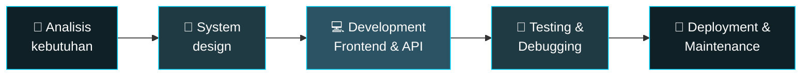

[](./assets/header.svg)

<p align="center">
  <a href="https://git.io/typing-svg">
    
  </a>
</p>

<p align="center">
  <a href="https://www.linkedin.com/in/mochammad-anda-fadholli-03b144293"></a>
  <a href="mailto:mandafadholli@gmail.com"></a>
  
</p>

[](./assets/tech-marquee.svg)

[](./assets/divider.svg)

## 👨‍💻 Tentang Saya

Saya Software Engineer dari Semarang, lulusan **D3 Teknik Informatika Politeknik Negeri Semarang** dengan **IPK 3,89/4,00 (Cum Laude)**. Saya senang membangun aplikasi berbasis web, mulai dari antarmuka (frontend), backend, hingga REST API, dengan pendekatan yang terstruktur: memahami kebutuhan pengguna lebih dulu, lalu membangun solusi yang bersih, efisien, dan mudah dikembangkan.

Saat ini saya bekerja sebagai **Web Developer di Digivora**, dengan stack utama **Laravel**, **Vue.js**, **React.js**, dan **Next.js**.

```js
const anda = {
  name: "Mochammad Anda Fadholli",
  role: "Web Developer (Full-Stack)",
  location: "Semarang, Jawa Tengah 🇮🇩",
  education: "D3 Teknik Informatika, Politeknik Negeri Semarang (IPK 3,89/4,00 - Cum Laude)",
  currentlyWorking: "Web Developer @ Digivora",
  mainStack: ["Laravel", "Vue.js", "React.js", "Next.js", "Express.js"],
  certification: "Junior Mobile Programming (BNSP, 2024)",
};
```

[](./assets/divider.svg)

## 🔭 Yang Saya Kerjakan

- 🌐 **Membangun aplikasi & dashboard web** dengan Laravel, AdminLTE, Vue.js, React.js, dan Next.js
- ⚙️ **Mengembangkan REST API & database** menggunakan Laravel, PHP, dan ExpressJs
- 🔗 **Mengintegrasikan frontend dengan backend, API pihak ketiga, dan model berbasis Python**
- 📦 **Mendigitalisasi proses manual**, seperti sistem inventaris bahan baku yang dipakai lebih dari **5 dapur MBG di Jawa Tengah**
- 🛠️ **Debugging & optimasi** untuk meningkatkan stabilitas, performa, dan usability aplikasi

[](./assets/divider.svg)

## 🔄 Cara Saya Bekerja



[](./assets/divider.svg)

## 🛠️ Tech Stack

### 🌐 Frontend


### ⚙️ Backend


### 🗄️ Database & Tools


[](./assets/divider.svg)

## 💼 Pengalaman Kerja

| Periode | Posisi | Tempat |
|---------|--------|--------|
| Jun 2026 – Sekarang | **Web Developer** | Digivora, Semarang |
| Des 2025 – Jun 2026 | **Programmer** | CV. Izza Nusa Persada, Semarang |
| Agu 2024 – Des 2024 | **Full-Stack Developer (Intern)** | Sekretariat Daerah Jawa Tengah |

<details>
<summary><b>🔹 Web Developer — Digivora</b> (Jun 2026 – Sekarang)</summary>

<br/>

Perusahaan rintisan di bidang digital solutions dan pengembangan aplikasi berbasis web.

- Mengembangkan aplikasi berbasis web dari analisis kebutuhan hingga deployment dan maintenance.
- Mengembangkan frontend, backend, dan REST API menggunakan Laravel, PHP, JavaScript, Vue.js, dan React.js.
- Merancang database dan mengintegrasikan sistem dengan API serta layanan pihak ketiga.
- Berkolaborasi dengan tim dalam analisis kebutuhan, system design, development, dan testing.
- Melakukan debugging dan optimasi aplikasi untuk meningkatkan stabilitas, performa, dan usability.

</details>

<details>
<summary><b>🔹 Programmer — CV. Izza Nusa Persada</b> (Des 2025 – Jun 2026)</summary>

<br/>

Software house yang berfokus pada pengembangan teknologi tepat guna, aplikasi web, dan solusi digital.

- Mengembangkan aplikasi manajemen bahan baku untuk monitoring inventaris dapur menggunakan **Laravel dan AdminLTE**.
- Mengembangkan modul master data, transaksi, inventory, dan pelaporan untuk operasional perusahaan.
- Mengembangkan sistem yang mendukung operasional lebih dari **5 dapur MBG di Jawa Tengah**.
- Mendigitalisasi proses pendataan dan pelaporan bahan baku untuk mengurangi proses manual antar dapur.

</details>

<details>
<summary><b>🔹 Full-Stack Developer (Intern) — Sekretariat Daerah Jawa Tengah</b> (Agu 2024 – Des 2024)</summary>

<br/>

- Mengembangkan aplikasi web untuk koordinasi dan pemantauan tugas operasional dengan **React.js dan REST API ExpressJs**.
- Mengintegrasikan frontend React.js dengan backend API sehingga proses input dan pengolahan data **30% lebih cepat**.
- Meningkatkan efisiensi pengelolaan data batas wilayah hingga **30% lebih cepat** dibanding proses manual.

</details>

[](./assets/divider.svg)

## 🚀 Proyek Unggulan

| Proyek | Peran | Teknologi | Deskripsi |
|--------|-------|-----------|-----------|
| 🏋️ **Arletta Gym** (2026) | Full-Stack Developer | Laravel, Vue.js | Dashboard sistem informasi manajemen pusat kebugaran: pendaftaran & administrasi member dan trainer, serta pembayaran terintegrasi (in-app payment). Arsitektur monolitik. |
| 🩻 **dRadiographiq** (2026) | Front-End Developer | Next.js, Python | Decision Support System (DSS) berbasis web untuk menganalisis kelayakan gambar Thorax, dengan antarmuka responsif yang terintegrasi dengan model Python. |
| 🧠 **SidestCT** (2026) | Front-End Developer | Next.js, Python | Aplikasi web untuk menganalisis gambar CT scan kepala guna mendeteksi stroke, terintegrasi dengan model analisis citra medis berbasis Python. |
| 🍽️ **Dapoer MBG** (2026) | Full-Stack Developer | Laravel, AdminLTE | Sistem informasi operasional: pencatatan pengeluaran, manajemen stok, dan laporan transaksi dengan dashboard interaktif. Arsitektur monolitik. |

[](./assets/divider.svg)

## 🎓 Pendidikan & Organisasi

**Politeknik Negeri Semarang** — Diploma Teknik Informatika (Sep 2022 – Sep 2025) · **IPK 3,89/4,00**

- Aktif mengikuti pelatihan dan sertifikasi untuk meningkatkan kompetensi teknis.
- Full-Stack Developer pada **Project Agrinova**, website manajemen perkebunan.

**UKM Polytechnic Computer Club (PCC)** — Staff Divisi HRD & Penelitian dan Pengembangan (Mei 2023 – Mei 2025)

- Melatih lebih dari **40 anggota baru** dalam public speaking dan manajemen waktu.
- Menyusun rekomendasi kebijakan internal yang meningkatkan kepuasan anggota sebesar **20%**.
- Berkontribusi dalam **Techcomfest** dan **Seminar Nasional PCC 2024** dengan sponsorship senilai **Rp10.000.000+** dari 5 mitra eksternal.

**🏆 Sertifikasi:** Junior Mobile Programming (2024), diselenggarakan BNSP bekerja sama dengan Politeknik Negeri Semarang.

[](./assets/divider.svg)

## 📊 Aktivitas GitHub

[](https://github.com/MochammadAnda)
[](https://github.com/MochammadAnda)


[](./assets/divider.svg)

## 📫 Mari Terhubung

Silakan hubungi saya untuk berdiskusi soal web development, kolaborasi, atau sekadar menyapa.

[](https://www.linkedin.com/in/mochammad-anda-fadholli-03b144293)
[](mailto:mandafadholli@gmail.com)

*💡 "Make it work, make it right, make it fast." — Kent Beck*
